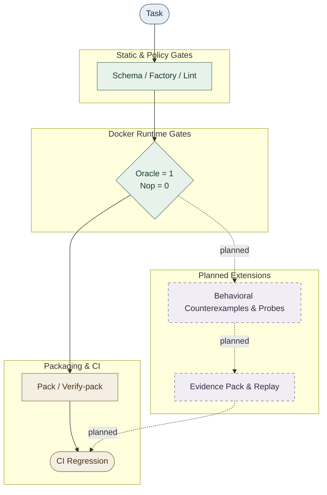

<h1 align="center">honestenv</h1>
<p align="center">Verifiable agent tasks, checked before they ship.</p>
<p align="center"><a href="README.md">English</a> · <a href="README.zh-CN.md">简体中文</a></p>
<p align="center">
  <a href="https://pypi.org/project/honestenv/0.1.1/"></a>
  <a href="https://pypi.org/project/honestenv/"></a>
  <a href="LICENSE"></a>
  <a href="https://github.com/EZfan/honestenv/actions/workflows/ci.yml"></a>
</p>

honestenv provides quality gates and task packs for [Harbor](https://docs.harborframework.com/)-compatible agent tasks.

[Quickstart](#quickstart) · [Scope](#scope) · [Workflow](#workflow) · [CLI](#cli) · [CI](#ci) · [Limitations and roadmap](#limitations-and-roadmap)

## Quickstart

With Python 3.12 or newer, install the published package with either:

```sh
pip install honestenv
```

```sh
uv tool install honestenv
```

Create a task skeleton and run its static gates:

```sh
honestenv init my-org/my-task
honestenv check tasks/my-task --static-only
```

The generated task is local to your current directory. Full checks require Docker and Docker Compose.

## Scope

| Tool / stage | Role |
| --- | --- |
| Harbor `lint` | Checks task configuration, isolation, image pinning, and common runtime risks; honestenv reuses it. |
| OpenEnv `openenv validate` | Validates environment structure and operability; its Harbor binding supports semantic checks subject to the execution environment. |
| honestenv 0.1.1 | Adds factory policy, Docker oracle/nop gates, checked snapshot packing, and manifest verification. |
| honestenv planned | Behavioral counterexamples, shortcut probes, evidence-pack replay, and post-fix regression gates are not 0.1.1 features. |

OpenEnv 0.15.0's Harbor dependency is 0.25.0, so it needs a separate environment from honestenv's pinned Harbor 0.27.0. In a local Docker comparison on two 0.1.1 tasks, runtime and dependent semantic checks were skipped even after adding the required manifest because the verifier environment is separate; skipped checks should not be described as missed defects.

## Workflow



Solid arrows show an available check and CI path; dashed arrows are planned capabilities. Today `verify-pack` checks the manifest and content hashes; it does not replay runtime evidence.

## Checkout examples

<details>
<summary>View task pack examples</summary>

The wheel does not include the repository task pack. Check out the 0.1.1 tag to use the versioned examples:

```sh
git clone --branch v0.1.1 https://github.com/EZfan/honestenv.git
cd honestenv
pip install -e .
```

Run the static gates on all local tasks:

```sh
honestenv test-gates --static-only
```

Full checks require Docker and Docker Compose. Check the first task and copy it into a new dataset directory:

```sh
honestenv check tasks/reservation-window --out report.json
honestenv pack tasks/reservation-window --into dataset
honestenv verify-pack dataset
```

The original deterministic tasks are [`tasks/reservation-window`](tasks/reservation-window), [`tasks/version-compare`](tasks/version-compare), [`tasks/invoice-cents`](tasks/invoice-cents), [`tasks/cut-field`](tasks/cut-field), [`tasks/bind-config`](tasks/bind-config), [`tasks/quoted-csv`](tasks/quoted-csv), [`tasks/text-normalize`](tasks/text-normalize), [`tasks/record-sort`](tasks/record-sort), [`tasks/job-order`](tasks/job-order), and [`tasks/date-shift`](tasks/date-shift). All use Harbor schema 1.4. Their verifiers run submitted code in unprivileged subprocesses and check its returned results before awarding a reward.

</details>

## CLI at a glance

| Command | Purpose |
| --- | --- |
| `init` | Create a task skeleton. |
| `check` | Check one task; `--static-only` skips runtime. |
| `test-gates` | Check tasks under `tasks/`. |
| `pack` | Check and pack a private snapshot. |
| `verify-pack` | Verify the manifest and content hashes without Docker. |

## CLI

<details>
<summary>Command and manifest details</summary>

- `honestenv init <org/task> [--force]` writes a task skeleton to `tasks/<task>` in the current directory and records `org/task` as the task name. Each component must start with a letter or digit and contain only ASCII letters, digits, dots, hyphens, and underscores. Neither component may contain `..`. An existing empty directory can be used. A non-empty destination requires `--force`, which may overwrite its files.
- `honestenv check <task-dir> [--static-only] [--out report.json]` runs schema checks, factory policy checks, `harbor lint --extend-select ALL`, and official Docker-backed `harbor run` checks. The built-in solution agent (`-a oracle`) must return a valid reward of exactly 1.0, and the empty agent (`-a nop`) must return a valid reward of exactly 0.0. With `--static-only`, it skips the runtime checks. The command optionally writes a JSON report.
- `honestenv test-gates [--static-only]` runs the same checks for every task under `tasks/`. With `--static-only`, it runs schema, factory policy, and lint checks.
- `honestenv pack <task-dir> --into <dataset-dir>` creates a private snapshot, runs the full check on it, and copies that checked snapshot into the dataset. It rejects symbolic links and special files and preserves ordinary file permissions, including executable bits. It refuses to pack if checks fail or if the destination task directory already exists. It writes or updates `dataset-manifest.json` in the dataset. Use one pack writer per dataset. An interruption between moving the task and updating the manifest can leave an unlisted task, which `verify-pack` rejects.
- `honestenv verify-pack <dataset-dir>` checks the manifest, task hashes, schema versions, and unlisted task directories without running Harbor or Docker. The recorded tool version is provenance and need not match the running version.

The manifest is a JSON object with a `tasks` object keyed by task directory name.
Each entry contains `content_sha256`, `schema_version`, `checked_at` (UTC
ISO-8601 ending in `Z`), and `honestenv_version`. The content hash is SHA-256
over task files in sorted relative POSIX path order. For each file, the UTF-8
path and file bytes are each preceded by their length as an 8-byte big-endian
integer. The digest is lowercase hexadecimal. Compare a check report’s `package.content_hash` to the manifest entry to check that they describe the same file content. The hash does not include permissions, empty directories, images, runtime, or network configuration. Packing checks the snapshot’s permissions and content for changes during the check.

</details>

## CI

Repositories with tasks in `tasks/` can call the reusable workflow. Replace both
`<ref>` values with the same commit SHA or tag of this repository:

```yaml
jobs:
  honestenv:
    permissions:
      contents: read
      pull-requests: write
    uses: EZfan/honestenv/.github/workflows/honestenv-check.yml@<ref>
    with:
      honestenv-ref: <ref>
```

The workflow checks out the caller's repository and the specified honestenv ref.
Its `test` job installs honestenv and runs static gates on all shipped tasks.
To run caller tests as well, set the optional `test-command` input to a shell command,
for example `python -m unittest discover -s tests -v`. Its `runtime` job runs official
Docker-backed Harbor gates. On pull requests it compares changes since the merge base with the base SHA:
changes under a shipped `tasks/<name>/` select that task; changes under `src/`,
`pyproject.toml`, `.github/workflows/`, or `.github/actions/` select all tasks.
Other changes skip runtime gates. Pushes to main run all tasks. Only directories
under `tasks/` containing `task.toml` are shipped tasks; canary fixtures are not.

On pull requests, the runtime job posts or updates a Markdown checkup with each
task's schema, lint, factory, and runtime results. Unchanged tasks have runtime
marked skipped. It uses the default `GITHUB_TOKEN`; grant `contents: read` and
`pull-requests: write` to the calling job. Fork pull requests may receive a
read-only token, so their checkup comment may be unavailable. Comment publication
failures produce a warning and do not change the task-check result.

A reusable workflow's checks are named `<caller-job> / test` and
`<caller-job> / runtime`. To keep exact check names `test` and `runtime`, compose
the actions as steps in your own jobs instead:

```yaml
jobs:
  test:
    runs-on: ubuntu-latest
    steps:
      - uses: actions/checkout@v7
      - uses: EZfan/honestenv/.github/actions/test@<ref>
  runtime:
    runs-on: ubuntu-latest
    timeout-minutes: 30
    permissions:
      contents: read
      pull-requests: write
    steps:
      - uses: actions/checkout@v7
        with:
          fetch-depth: 0
      - uses: EZfan/honestenv/.github/actions/runtime@<ref>
```

Use a commit SHA or tag for each `<ref>`. The runtime action requires full Git
history to compare the PR base. This repository uses these composite actions in
its own `test` and `runtime` jobs. A standalone action repository may come later.

## Factory policy

Factory checks require digest-pinned images in Dockerfiles and `environment.docker_image`, an explicit separate verifier, a non-root agent user, and a restricted agent network policy. Set `environment.network_mode` to `"no-network"`, or use a non-empty restricted allowlist. The agent can override the environment policy. Dockerfiles must not use host networking, and test material must not fetch from public hosts. Reward scripts are checked for obvious unconditional rewards, failure exits, nondeterminism, and missing checks of packaged artifacts. These static checks are heuristics and can produce false positives, including for comments containing `date`. Passing them does not prove a verifier is correct. Runtime gates check the oracle and empty agent, not every possible solution.

The intentionally invalid packages in `tests/fixtures/bad_tasks/` verify that the
factory gates reject bad tasks. They are not part of the shipped `tasks/` pack.

The Headroom Policy requires an explicit, finite `verifier.timeout_sec` of at least 15 seconds. If `metadata.expected_oracle_runtime_sec` is a finite positive number, the timeout must also be at least three times that value.

## Limitations and roadmap

<details>
<summary>Known limitations and planned stages</summary>

- **HE-003:** Static heuristics can produce false positives, including `date` in comments; passing checks does not prove a verifier correct.
- **v0.1.x:** Improve the reproducible CLI, rule IDs, and explicit result states.
- **v0.5 (planned):** Versioned quality profiles, case and evidence schemas, and independent compatibility tests.
- **v1.0 (planned):** Explore extension interfaces, migration policies, and interoperability across implementations; multi-party adoption still needs evidence.

</details>

## Status

Version 0.1.1 includes static and Docker-backed runtime gates, task initialization, packing and pack verification, incremental CI checks, and ten shipped tasks.

## License

[Apache-2.0](LICENSE).

## Project links

[Contributing](CONTRIBUTING.md) | [Changelog](CHANGELOG.md) | [Security](SECURITY.md) | [Code of Conduct](CODE_OF_CONDUCT.md)
