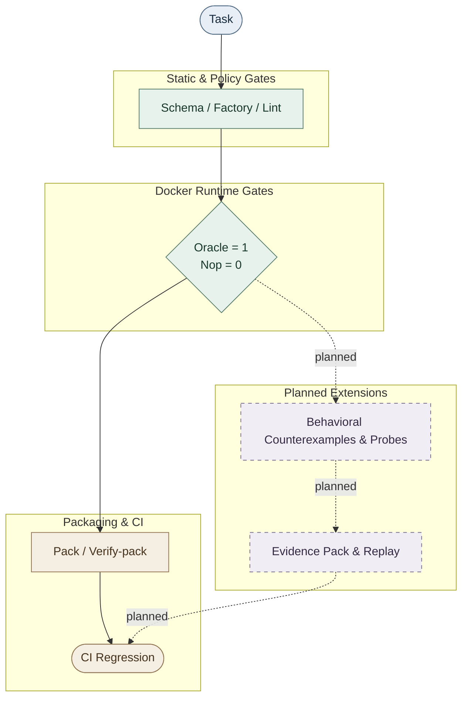

<h1 align="center">honestenv</h1>
<p align="center">可验证的智能体任务，在交付前完成检查。</p>
<p align="center"><a href="README.md">English</a> · <a href="README.zh-CN.md">简体中文</a></p>
<p align="center">
  <a href="https://pypi.org/project/honestenv/0.1.1/"></a>
  <a href="https://pypi.org/project/honestenv/"></a>
  <a href="LICENSE"></a>
  <a href="https://github.com/EZfan/honestenv/actions/workflows/ci.yml"></a>
</p>

honestenv 是兼容 [Harbor](https://docs.harborframework.com/) 的智能体任务质量门禁和任务包工具。

[快速开始](#快速开始) · [分工与范围](#分工与范围) · [工作流](#工作流) · [CLI](#cli) · [CI](#ci) · [已知限制与路线图](#已知限制与路线图)

## 快速开始

使用 Python 3.12 或更高版本，通过以下任一方式安装已发布的包：

```sh
pip install honestenv
```

```sh
uv tool install honestenv
```

创建任务骨架并运行静态门禁：

```sh
honestenv init my-org/my-task
honestenv check tasks/my-task --static-only
```

生成的任务位于当前目录中。完整检查需要 Docker 和 Docker Compose。

## 分工与范围

| 工具 / 阶段 | 作用 |
| --- | --- |
| Harbor `lint` | 检查任务配置、隔离、镜像固定及常见运行风险；honestenv 复用它。 |
| OpenEnv `openenv validate` | 校验环境结构与运行能力；Harbor 绑定支持语义检查，但执行范围取决于运行环境。 |
| honestenv 0.1.1 | 补充工厂策略、Docker oracle/nop 门禁、检查过的快照打包与清单核验。 |
| honestenv 规划 | 行为反例、捷径探针、证据包重放和修复后回归门禁；尚非 0.1.1 功能。 |

OpenEnv 0.15.0 的 Harbor 依赖为 0.25.0，与 honestenv 固定的 Harbor 0.27.0 需要分环境使用。对两道 0.1.1 任务的本地 Docker 对标中，补充所需清单后仍因独立 verifier 环境而跳过运行时及依赖它的语义检查；这不应被解释为这些检查的漏检。

## 工作流



实线表示现有检查和 CI 的使用路径；虚线表示规划能力。当前 `verify-pack` 核验清单和内容哈希，不重放运行证据。

## 检出示例

<details>
<summary>查看任务包示例</summary>

wheel 不包含仓库中的任务包。检出 0.1.1 标签以使用该版本的示例：

```sh
git clone --branch v0.1.1 https://github.com/EZfan/honestenv.git
cd honestenv
pip install -e .
```

对所有本地任务运行静态门禁：

```sh
honestenv test-gates --static-only
```

完整检查需要 Docker 和 Docker Compose。检查第一个任务，然后将其复制到新的数据集目录：

```sh
honestenv check tasks/reservation-window --out report.json
honestenv pack tasks/reservation-window --into dataset
honestenv verify-pack dataset
```

原有的确定性任务包括 [`tasks/reservation-window`](tasks/reservation-window)、[`tasks/version-compare`](tasks/version-compare)、[`tasks/invoice-cents`](tasks/invoice-cents)、[`tasks/cut-field`](tasks/cut-field)、[`tasks/bind-config`](tasks/bind-config)、[`tasks/quoted-csv`](tasks/quoted-csv)、[`tasks/text-normalize`](tasks/text-normalize)、[`tasks/record-sort`](tasks/record-sort)、[`tasks/job-order`](tasks/job-order) 和 [`tasks/date-shift`](tasks/date-shift)。它们都使用 Harbor schema 1.4。验证器在非特权子进程中运行提交的代码，并检查返回结果后才给出奖励。

</details>

## CLI 速查

| 命令 | 用途 |
| --- | --- |
| `init` | 创建任务骨架。 |
| `check` | 检查单个任务；`--static-only` 跳过运行时。 |
| `test-gates` | 检查 `tasks/` 中的任务。 |
| `pack` | 检查私有快照并打包。 |
| `verify-pack` | 核验清单和内容哈希，无需 Docker。 |

## CLI

<details>
<summary>命令及清单详情</summary>

- `honestenv init <org/task> [--force]` 在当前目录的 `tasks/<task>` 中写入任务骨架，并将 `org/task` 记录为任务名称。每个部分必须以字母或数字开头，且只能包含 ASCII 字母、数字、点、连字符和下划线。任何部分都不能包含 `..`。可以使用已有的空目录。非空目标目录需要使用 `--force`，该选项可能覆盖其中的文件。
- `honestenv check <task-dir> [--static-only] [--out report.json]` 运行 schema 检查、工厂策略检查、`harbor lint --extend-select ALL` 和官方的 Docker 支持的 `harbor run` 检查。内置解答智能体（`-a oracle`）必须返回恰好为 1.0 的有效奖励，空智能体（`-a nop`）必须返回恰好为 0.0 的有效奖励。使用 `--static-only` 时，命令跳过运行时检查。该命令可以选择写入 JSON 报告。
- `honestenv test-gates [--static-only]` 对 `tasks/` 下的每个任务运行相同的检查。使用 `--static-only` 时，命令运行 schema、工厂策略和 lint 检查。
- `honestenv pack <task-dir> --into <dataset-dir>` 创建私有快照，对其运行完整检查，然后将检查过的快照复制到数据集中。该命令拒绝符号链接和特殊文件，并保留普通文件的权限，包括可执行位。如果检查失败或目标任务目录已存在，命令会拒绝打包。命令会在数据集中写入或更新 `dataset-manifest.json`。每个数据集只使用一个打包写入进程。如果在移动任务和更新清单之间发生中断，可能留下未列入清单的任务，`verify-pack` 会拒绝该数据集。
- `honestenv verify-pack <dataset-dir>` 检查清单、任务哈希、schema 版本和未列入清单的任务目录，不运行 Harbor 或 Docker。记录的工具版本用于追溯来源，不必与当前运行的版本一致。

清单是一个 JSON 对象，其中的 `tasks` 对象以任务目录名为键。每个条目包含 `content_sha256`、`schema_version`、`checked_at`（以 `Z` 结尾的 UTC ISO-8601 时间）和 `honestenv_version`。内容哈希是对任务文件按 POSIX 相对路径排序后计算的 SHA-256。每个文件的 UTF-8 路径和文件字节分别以其长度作为前缀，长度使用 8 字节大端整数表示。摘要使用小写十六进制。比较检查报告中的 `package.content_hash` 和清单条目，可以确认两者描述的是相同的文件内容。哈希不包含权限、空目录、镜像、运行时或网络配置。打包时会检查快照的权限和内容是否在检查期间发生变化。

</details>

## CI

在 `tasks/` 中包含任务的仓库可以调用可复用工作流。将两个 `<ref>` 值都替换为本仓库的同一个提交 SHA 或标签：

```yaml
jobs:
  honestenv:
    permissions:
      contents: read
      pull-requests: write
    uses: EZfan/honestenv/.github/workflows/honestenv-check.yml@<ref>
    with:
      honestenv-ref: <ref>
```

工作流会检出调用方的仓库和指定的 honestenv ref。其 `test` 作业安装 honestenv，并对所有随附任务运行静态门禁。若还要运行调用方的测试，将可选输入 `test-command` 设为 shell 命令，例如 `python -m unittest discover -s tests -v`。其 `runtime` 作业运行官方的 Docker 支持的 Harbor 门禁。在拉取请求中，工作流比较自合并基点以来相对于基础 SHA 的更改：随附的 `tasks/<name>/` 下的更改会选择该任务；`src/`、`pyproject.toml`、`.github/workflows/` 或 `.github/actions/` 下的更改会选择所有任务。其他更改会跳过运行时门禁。推送到 main 时会运行所有任务。只有 `tasks/` 下包含 `task.toml` 的目录才是随附任务；金丝雀测试夹具不属于随附任务。

在拉取请求中，运行时作业会发布或更新一份 Markdown 检查报告，列出每个任务的 schema、lint、工厂和运行时结果。未更改任务的运行时结果标记为已跳过。该作业使用默认的 `GITHUB_TOKEN`；请向调用作业授予 `contents: read` 和 `pull-requests: write` 权限。来自 fork 的拉取请求可能收到只读令牌，因此检查报告评论可能无法发布。评论发布失败会产生警告，但不会改变任务检查结果。

可复用工作流的检查名为 `<caller-job> / test` 和 `<caller-job> / runtime`。若要保持检查名称严格为 `test` 和 `runtime`，可以在自己的作业中将这些 action 组合为步骤：

```yaml
jobs:
  test:
    runs-on: ubuntu-latest
    steps:
      - uses: actions/checkout@v7
      - uses: EZfan/honestenv/.github/actions/test@<ref>
  runtime:
    runs-on: ubuntu-latest
    timeout-minutes: 30
    permissions:
      contents: read
      pull-requests: write
    steps:
      - uses: actions/checkout@v7
        with:
          fetch-depth: 0
      - uses: EZfan/honestenv/.github/actions/runtime@<ref>
```

每个 `<ref>` 都应使用提交 SHA 或标签。runtime action 需要完整的 Git 历史记录来比较拉取请求的基础版本。本仓库在自己的 `test` 和 `runtime` 作业中使用这些复合 action。未来可能会提供独立的 action 仓库。

## 工厂策略

工厂检查要求 Dockerfile 和 `environment.docker_image` 中的镜像使用摘要固定，要求显式分离的验证器、非 root 智能体用户以及受限的智能体网络策略。将 `environment.network_mode` 设为 `"no-network"`，或者使用非空的受限允许列表。智能体可以覆盖环境策略。Dockerfile 不得使用主机网络，测试材料不得从公共主机获取内容。奖励脚本会接受检查，以发现明显的无条件奖励、失败退出、非确定性以及缺少对打包产物的检查。这些静态检查是启发式的，可能产生误报，包括注释中包含 `date` 的情况。通过这些检查并不能证明验证器正确。运行时门禁检查 oracle 和空智能体，而非所有可能的解答。

`tests/fixtures/bad_tasks/` 中故意设为无效的包用于验证工厂门禁会拒绝不合格任务。它们不属于随附的 `tasks/` 任务包。

Headroom Policy 要求显式设置有限的 `verifier.timeout_sec`，且至少为 15 秒。如果 `metadata.expected_oracle_runtime_sec` 是有限正数，超时时间还必须至少为该值的三倍。

## 已知限制与路线图

<details>
<summary>已知限制与计划阶段</summary>

- **HE-003：**静态启发式可能误报，例如注释中的 `date`；通过检查也不能证明验证器正确。
- **v0.1.x：**完善可复现 CLI、规则 ID 与明确的结果状态。
- **v0.5（规划）：**版本化质量 profile、案例与证据 schema、独立兼容测试。
- **v1.0（规划）：**探索扩展接口、迁移政策和跨实现互操作；多方采用仍需实际证据。

</details>

## 状态

版本 0.1.1 包含静态门禁、Docker 支持的运行时门禁、任务初始化、打包和包验证、增量 CI 检查以及十个随附任务。

## 许可证

[Apache-2.0](LICENSE)。

## 项目链接

[贡献指南](CONTRIBUTING.md) | [更新日志](CHANGELOG.md) | [安全](SECURITY.md) | [行为准则](CODE_OF_CONDUCT.md)
